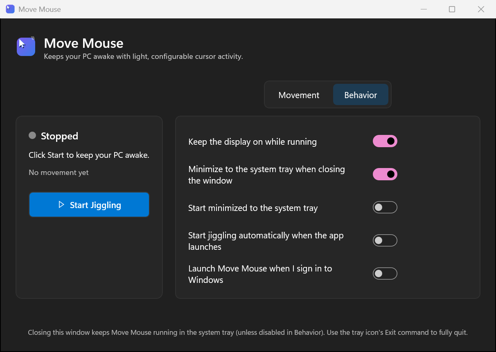
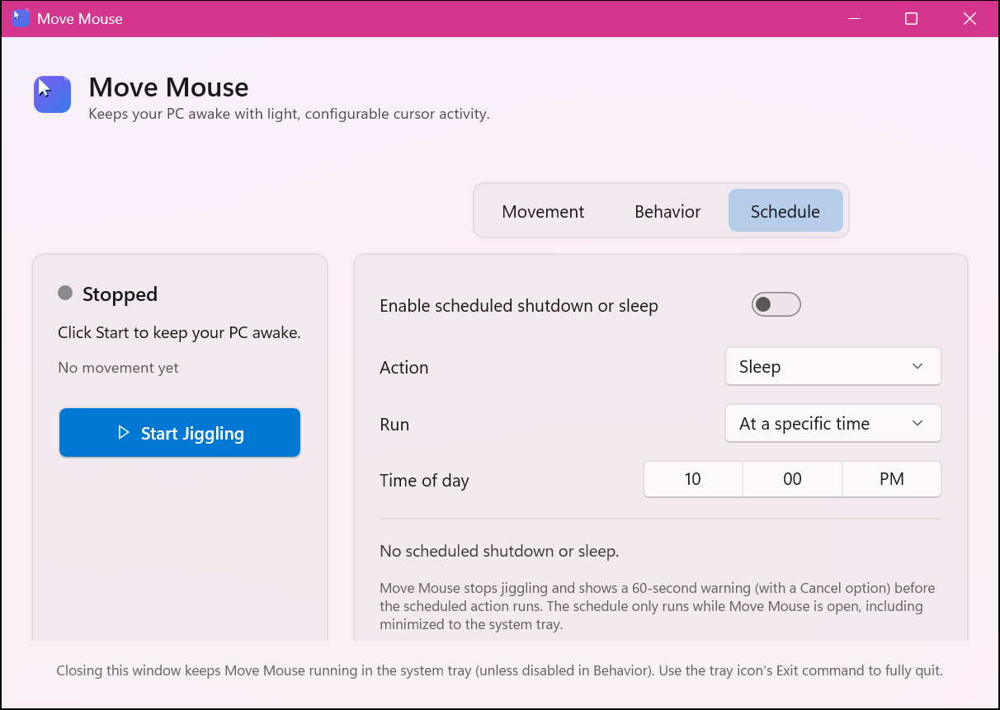
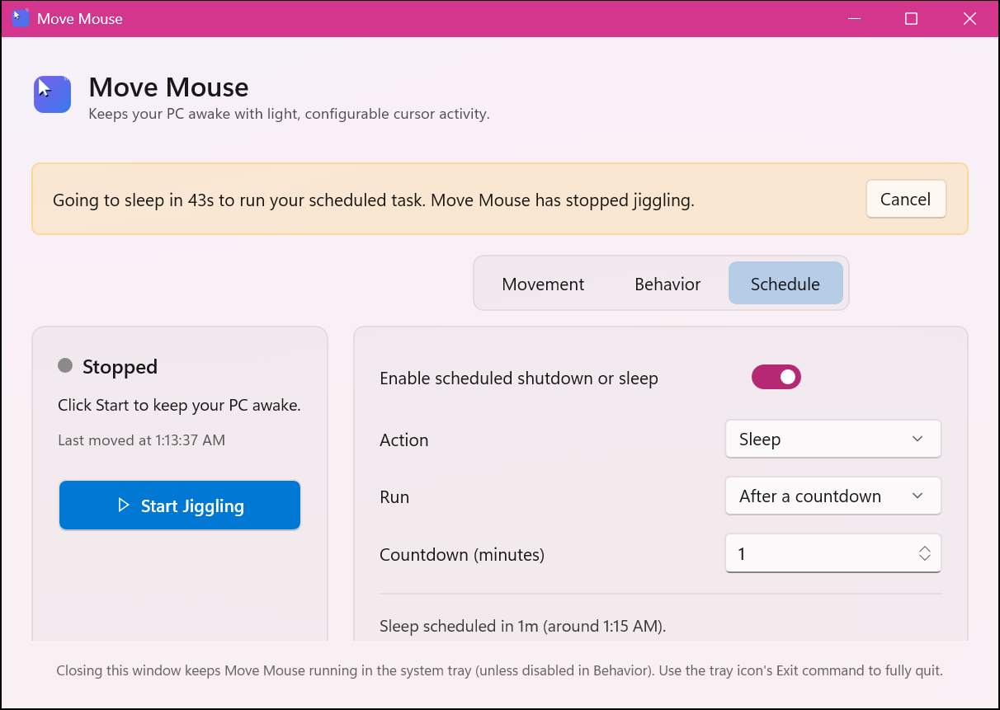

# Move Mouse

A modern, native Windows desktop application that gently simulates mouse activity to keep your PC from going to sleep, locking, or dimming the display — built with **C#**, **.NET**, and **WinUI 3** following Windows 11 Fluent Design, with a wide, tabbed dashboard, a translucent Mica backdrop, and an optional scheduled shutdown/sleep timer.


## Overview

Move Mouse is a "mouse jiggler" utility for people who need their computer to stay awake and show as active — during long downloads, remote monitoring sessions, presentations, unattended demos, or simply to stop Windows from locking the screen during short breaks. Instead of a giant, jarring cursor swing, Move Mouse nudges the pointer by a small, configurable amount on a timer and tells Windows directly that the system should not sleep, using the same APIs Windows itself recommends for this purpose.

It is a fully unpackaged, self-contained WinUI 3 application: no MSIX installation or Microsoft Store is required. Clone, build, and run.

## Features

- **Mouse jiggler** — periodically moves the cursor by a small amount to simulate user activity.
- **Single Start/Stop toggle** — one button for both actions; its color, icon, and label (▶ *Start Jiggling* / ⏹ *Stop Jiggling*) always reflect what it will do next, so the dashboard never shows a redundant, permanently-disabled button.
- **Horizontal, tabbed dashboard** — a wide WinUI 3 window with an always-visible status/control sidebar next to a centered, segmented **Movement** / **Behavior** / **Schedule** tab bar, so settings are grouped into focused pages instead of one long scrolling list. The sidebar and the settings card always match height, so the two-panel layout stays visually symmetric no matter which tab is open.
- **Translucent Mica backdrop** — the window background uses Windows 11's Mica material, with low-opacity "glass" panels layered on top, so the whole dashboard stays visually light and modern instead of flat and opaque.
- **Configurable interval** — choose how often the cursor moves, from 1 second up to 1 hour.
- **Multiple movement patterns**
  - **Random movement** — small, unpredictable nudges in any direction.
  - **Back and forth** — a subtle, repeating left/right wiggle.
  - **Circular nudge** — a tiny hexagonal approximation of a circle around the starting point.
- **Configurable movement distance** — 1–100 pixels.
- **Live status indicator** — a colored dot plus plain-English status text ("Running" / "Stopped"), a description of the active configuration, and a "last moved at" timestamp.
- **System tray support** — minimize to the notification area and keep running in the background; the tray icon itself changes to reflect whether jiggling is active, and its tooltip and right-click menu (Open / Start or Stop Jiggling / Exit) stay in sync with the app.
- **Sleep prevention** — uses the Win32 `SetThreadExecutionState` API to tell Windows the system (and, optionally, the display) must stay awake while running, and explicitly restores normal power management when stopped or when the app exits.
- **Scheduled shutdown or sleep** — optionally shut down or sleep the PC once at a specific time of day (every day) or after a one-time countdown. Move Mouse always stops jiggling and restores normal power management *before* the action runs, shows a 60-second warning banner with a **Cancel** button first, and sends a tray notification so you're never caught off guard.
- **Settings persistence** — every preference (interval, pattern, distance, tray behavior, startup behavior) is saved to disk automatically and restored the next time the app launches.
- **Launch at Windows startup** — optional, per-user registration (no administrator rights required).
- **Robust error handling** — native API failures and unexpected errors are caught and shown as a clear, dismissible in-app banner instead of crashing the app.
- **Light / dark theme** — follows the Windows system theme automatically.
- **Accessible** — every interactive control exposes a proper accessible name for screen readers and UI automation.

## Screenshots

| Light — Movement tab (stopped) | Light — Movement tab (running) |
| --- | --- |
|  |  |

The segmented **Movement** / **Behavior** / **Schedule** tab bar is centered
above the settings card, and the status/control sidebar on the left always
matches that card's height — including after switching to the taller
**Behavior** or **Schedule** tabs — instead of stretching to fill the window
or leaving a large empty gap under the Start/Stop button. Every settings row,
in every tab, shares the same two-column grid (a flexible label on the left,
a fixed-width control right-aligned to the same edge), so each tab reads as
one evenly balanced, symmetric list. The window follows the Windows
light/dark theme automatically:



| Schedule tab | Pre-action warning banner |
| --- | --- |
|  |  |

The second screenshot above shows the 60-second warning banner that appears
right before a scheduled shutdown or sleep runs — note the sidebar already
reads **Stopped**, because Move Mouse always stops jiggling and restores
normal power management first.

> The application icon (shown below) is a simple, original design generated for this project — a cursor with motion lines on a Fluent-style gradient tile.
>
> 

## Prerequisites

To **build** Move Mouse from source you need:

- Windows 10 version 1809 (build 17763) or later, or Windows 11 (recommended).
- [.NET SDK 9.0 or later](https://dotnet.microsoft.com/download) (the project targets `net10.0-windows10.0.19041.0`; adjust the `TargetFramework` in `src/MoveMouse/MoveMouse.csproj` if you only have an earlier SDK installed).
- Visual Studio 2022 17.8+ or Visual Studio 2026, **or** just the .NET SDK and `dotnet` CLI (no Visual Studio required).
- No Windows App SDK runtime installation is required — the app is built as **self-contained** (`WindowsAppSDKSelfContained=true`), so the Windows App Runtime binaries ship alongside the app.

To **run** the published app you only need a supported version of Windows 10/11 on x64 or ARM64 — no prerequisites to install.

## Repository layout

```
MoveMouse/
├── src/
│   ├── MoveMouse/             # WinUI 3 application (UI, view models, services, Win32 interop)
│   │   ├── Assets/            # App and tray icons
│   │   ├── Converters/        # XAML value converters
│   │   ├── Interop/           # P/Invoke declarations (SendInput, SetThreadExecutionState, SetSuspendState, ...)
│   │   ├── Models/            # AppSettings, MovementMode, ScheduledActionType, ScheduledActionTriggerMode
│   │   ├── Services/          # Mouse jiggler, power management, settings, startup registration, scheduled power action
│   │   ├── ViewModels/        # MainViewModel (CommunityToolkit.Mvvm)
│   │   ├── App.xaml(.cs)      # Application entry / composition root
│   │   └── MainWindow.xaml(.cs)
│   └── MoveMouse.Tray/        # Small class library providing the system tray icon
│                               # (kept separate because WinUI 3 + Windows Forms cannot
│                               #  coexist in a single project; see note in its .csproj)
├── tools/IconGen/              # One-off script used to generate the app/tray icons
├── docs/screenshots/           # Screenshots used in this README
├── MoveMouse.sln
├── LICENSE
└── README.md
```

### Architecture

Move Mouse follows a clean separation of concerns:

- **`Interop`** — all native Win32 interop (`SendInput`, `SetThreadExecutionState`, `SetSuspendState`, `GetCursorPos`, `GetSystemMetrics`) lives behind a single internal static class, isolated from the rest of the app.
- **`Services`** — small, single-purpose, interface-based services:
  - `IMouseJigglerService` — owns the timer and movement-pattern logic.
  - `IPowerManagementService` — owns sleep prevention and restoration.
  - `ISettingsService` — owns loading/saving JSON settings to local app data.
  - `IStartupService` — owns the Windows "launch at sign-in" registration.
  - `ITrayIconService` (in `MoveMouse.Tray`) — owns the notification-area icon, menu, and balloon notifications.
  - `IScheduledPowerActionService` — a self-contained, lock-guarded one-second timer that tracks the configured schedule (specific time of day or countdown) and raises events as the pre-action warning window opens, is cancelled, or the run time arrives. It knows nothing about the jiggler or how to actually shut down/sleep — it only answers "is it time yet?".
  - `IPowerActionExecutor` — the only piece of code that actually shuts down (`shutdown.exe /s /t 0`) or sleeps (`SetSuspendState`) the machine; kept as its own tiny interface so it is trivial to reason about and substitute in tests.
- **`ViewModels`** — `MainViewModel` (built with [CommunityToolkit.Mvvm](https://github.com/CommunityToolkit/dotnet)) coordinates the services and exposes bindable state/commands; it contains no direct Windows API calls. It is the only place that wires the scheduled-action service's events to "stop jiggling first" and "now call the executor" — mirroring the same orchestrator role it already plays between the jiggler and power-management services.
- **`App.xaml.cs`** — the composition root: constructs every service and the view model, and owns application lifetime (startup, exit, unhandled-exception safety net).
- **UI (XAML)** — binds only to the view model via classic `{Binding}`; all visuals use the control's own theme-aware default styling plus a handful of explicit, low-opacity accent/panel tint colors chosen so the window's Mica backdrop shows through (see the note at the top of `MainWindow.xaml` — in this project's unpackaged deployment, several named theme resources are not reliably resolved at XAML load time, so the UI intentionally avoids depending on them). Every settings row shares one consistent two-column grid (flexible label, fixed-width right-aligned control) for a symmetric, evenly balanced layout within each tab; a trio of `ShowMovementTabCommand`/`ShowBehaviorTabCommand`/`ShowScheduleTabCommand` relay commands and `IsMovementTabActive`/`IsBehaviorTabActive`/`IsScheduleTabActive` properties drive the centered, segmented pill tab bar. The sidebar card and the settings card are laid out in the same Grid row, so ordinary auto-row-sizing (not a fixed height) keeps them exactly the same height at all times, including when switching between the shorter Movement tab and the taller Behavior/Schedule tabs. A separate, amber-tinted banner (reusing the same hand-built pattern as the error banner) shows the scheduled-action warning countdown with its **Cancel** button. The window is sized through a DPI-aware helper so the layout looks correct at any Windows display scaling setting.

## Build instructions

Clone the repository and build with the .NET CLI:

```powershell
git clone https://github.com/erentechlabs/MoveMouse.git
cd MoveMouse
dotnet build MoveMouse.sln -c Release -p:Platform=x64
```

Or open `MoveMouse.sln` in Visual Studio, select the `x64` (or `ARM64`) platform and `Release` configuration, and press **Build**.

The runnable application is produced at:

```
src/MoveMouse/bin/x64/Release/net10.0-windows10.0.19041.0/MoveMouse.exe
```

### Publishing a single, self-contained build

To produce a redistributable folder that runs on a machine without any .NET or Windows App SDK installation:

```powershell
dotnet publish src/MoveMouse/MoveMouse.csproj -c Release -r win-x64 --self-contained true -p:Platform=x64
```

Replace `win-x64` with `win-arm64` for ARM64 devices.

## Usage

1. Launch `MoveMouse.exe`.
2. Click **Start Jiggling** (in the left sidebar) to begin — the status dot turns green, the button itself turns red and relabels to **Stop Jiggling**, Windows is told to stay awake, and the cursor will move by the configured amount at the configured interval. The sidebar is always visible, so you can start/stop from any settings tab.
3. Click the same button (now **Stop Jiggling**) at any time — the timer stops and normal Windows power management is restored immediately.
4. Use the **Movement** / **Behavior** / **Schedule** segmented tabs above the settings panel to switch between the three groups below.
5. On the **Movement** tab, adjust the interval, pattern, and distance at any time, whether running or stopped; changes apply immediately and are saved automatically.
6. On the **Behavior** tab, adjust:
   - *Keep the display on while running* — also prevents the monitor from turning off, not just the system from sleeping.
   - *Minimize to the system tray when closing the window* — clicking the window's **X** hides it instead of exiting; Move Mouse keeps running in the background.
   - *Start minimized to the system tray* — skip showing the window on launch.
   - *Start jiggling automatically when the app launches* — begin jiggling immediately on startup.
   - *Launch Move Mouse when I sign in to Windows* — registers/unregisters a per-user startup entry.
7. On the **Schedule** tab, optionally configure a one-time or daily shutdown/sleep — see [Scheduled shutdown and sleep](#scheduled-shutdown-and-sleep) below for the full behavior.
8. Use the **system tray icon** to reopen the window (click), or right-click it for **Open Move Mouse**, **Start/Stop Jiggling**, and **Exit**.
9. Choose **Exit** from the tray menu (or disable "minimize to tray" and close the window) to fully quit — this always stops jiggling and restores normal power management first.

Settings are stored in `%LOCALAPPDATA%\MoveMouse\settings.json`.

## How sleep prevention works

Move Mouse calls the Win32 [`SetThreadExecutionState`](https://learn.microsoft.com/windows/win32/api/winbase/nf-winbase-setthreadexecutionstate) API with `ES_CONTINUOUS | ES_SYSTEM_REQUIRED` (and optionally `ES_DISPLAY_REQUIRED`) when you start jiggling, and resets it to `ES_CONTINUOUS` alone — restoring normal behavior — when you stop jiggling, when the app exits, or if it encounters an unhandled error. Because this flag is tied to the application's UI thread for as long as the process runs, there is no need to re-issue the call on every tick.

Cursor movement itself is generated with [`SendInput`](https://learn.microsoft.com/windows/win32/api/winuser/nf-winuser-sendinput), the modern, Microsoft-recommended replacement for the legacy `mouse_event` API, using small relative moves that are clamped to the virtual screen bounds so the cursor never flies off-screen.

## Scheduled shutdown and sleep

The **Schedule** tab lets Move Mouse shut down or sleep the PC on its own, without any extra tooling:

1. Turn on **Enable scheduled shutdown or sleep**.
2. Choose the **Action**: **Sleep** or **Shut down**.
3. Choose **Run**:
   - **At a specific time** — pick a time of day with the time picker; the action runs every day at that time, for as long as the schedule stays enabled. Cancelling a run (step 5 below) only skips that one occurrence — the schedule is still active for tomorrow.
   - **After a countdown** — pick a number of minutes; the action runs once, that many minutes from when you turned the toggle on (or last changed the countdown/trigger mode). This is a one-shot schedule: once it runs (or is cancelled), the toggle turns itself back off.
4. The status line below updates live with the next computed run time (for example, *"Sleep scheduled for today at 10:00 PM (in 3h 12m)."*).
5. Sixty seconds before the action runs, Move Mouse:
   - **Stops jiggling and restores normal Windows power management immediately** — the whole point of this sequencing is that the jiggler's own activity, and the "stay awake" request it makes, never fight the shutdown/sleep that is about to happen.
   - Shows an amber warning banner at the top of the window (*"Going to sleep in 60s to run your scheduled task. Move Mouse has stopped jiggling."*) with a **Cancel** button.
   - Sends a system tray notification with the same message, in case the window is minimized.
6. If you don't cancel, Move Mouse shuts down (`shutdown.exe /s /t 0`, the same non-forced shutdown Windows itself performs from the Start menu) or sleeps (`SetSuspendState`) when the countdown reaches zero.

**Important:** this schedule runs entirely inside the Move Mouse process (there is no separate Windows Task Scheduler entry), so it only fires while Move Mouse is open — including minimized to the system tray. Fully exiting the app (via the tray **Exit** command) cancels any pending schedule.

## Testing performed

This application was built and verified end-to-end on a real Windows machine:

- `dotnet build` succeeds for both `Debug` and `Release`, `x64`, with zero warnings and zero errors.
- The app launches, and the dashboard renders correctly with no exceptions, in both light and dark Windows theme.
- **Start** engages the timer (verified by watching the "last moved at" timestamp advance on schedule) and **Stop** halts it immediately (verified by the timestamp freezing); the single toggle button correctly flips color/icon/label and the status dot/text in lockstep with the jiggler's actual running state — and continues to do so regardless of which settings tab is open.
- The **Movement** / **Behavior** / **Schedule** segmented tabs switch correctly in every direction, each showing its own settings without affecting the others, and without disturbing the always-visible sidebar; the sidebar card and the settings card are confirmed to always render at the same height, growing together when a taller tab (Behavior or Schedule) is opened and shrinking together back on the three-row Movement tab.
- Settings changes made in the UI are written to `settings.json` immediately and are reloaded correctly on the next launch.
- The system tray icon appears with the correct icon/tooltip for each state, its right-click menu items match the running state, left-clicking it (or choosing "Open Move Mouse") restores the window, and its **Exit** command cleanly terminates the process.
- Closing the window with "minimize to tray" enabled hides the window while the process keeps running in the background; the window can be restored from the tray.
- The "Launch at Windows startup" toggle correctly creates and removes the `HKCU\Software\Microsoft\Windows\CurrentVersion\Run` registry value.
- Exiting the app (via the tray **Exit** command) always completes without errors, having already stopped the jiggler and restored normal power management.
- **Scheduled shutdown/sleep**, verified live end-to-end with a 1-minute "after a countdown" schedule while jiggling was running:
  - Enabling the schedule immediately showed the live "next run" status text, and selecting "At a specific time" vs. "After a countdown" correctly swapped the time picker / countdown rows and recalculated the status text (e.g. *"Sleep scheduled for today at 10:00 PM (in 20h 43m)."*).
  - With 60 seconds remaining, the warning banner appeared, the tray balloon fired, and — critically — jiggling stopped and normal power management was restored *immediately*, confirmed by the sidebar status flipping to **Stopped** while the countdown was still running.
  - Clicking **Cancel** during the warning dismissed the banner and correctly turned the one-shot "after a countdown" schedule back off (an "at a specific time" cancel was confirmed, by code inspection and the shared timer logic, to instead skip only that day's run).
  - Letting a countdown run to completion correctly invoked the power-action step and then turned the one-shot schedule off automatically.
  - Because this was tested on a shared development machine, the final "actually call `shutdown.exe` / `SetSuspendState`" step was verified by substituting a logging test double for `IPowerActionExecutor` for that one run (confirming it was invoked with the correct action) rather than by letting the real machine shut down or sleep; the production build always uses the real `PowerActionExecutor`, and `dotnet build`/launch were re-verified against it afterward.

## Known limitation

In this unpackaged deployment configuration, a handful of WinUI 3's *named* theme resources (e.g. some used internally by `ComboBox` and `InfoBar`) are not reliably resolved at XAML load time in every environment. The UI works around this by using the built-in default control styles (unaffected) plus a small set of explicit, hardcoded colors for cards and the error banner, rather than the semantic `SystemFillColor*`/`CardBackgroundFillColorDefaultBrush` theme resources. The app still fully adapts to the Windows light/dark theme because every built-in control's own default appearance is theme-aware; only a few custom accent/card colors are fixed.

The scheduled shutdown/sleep feature runs on an in-process timer rather than a Windows Task Scheduler entry — see [Scheduled shutdown and sleep](#scheduled-shutdown-and-sleep) for what that means in practice.

## License

Licensed under the [MIT License](LICENSE).
