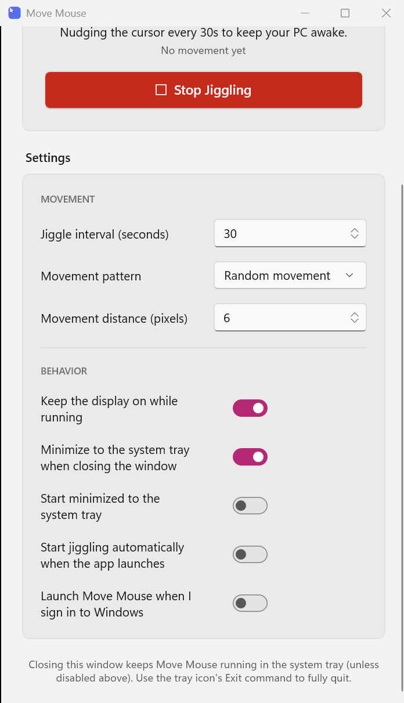
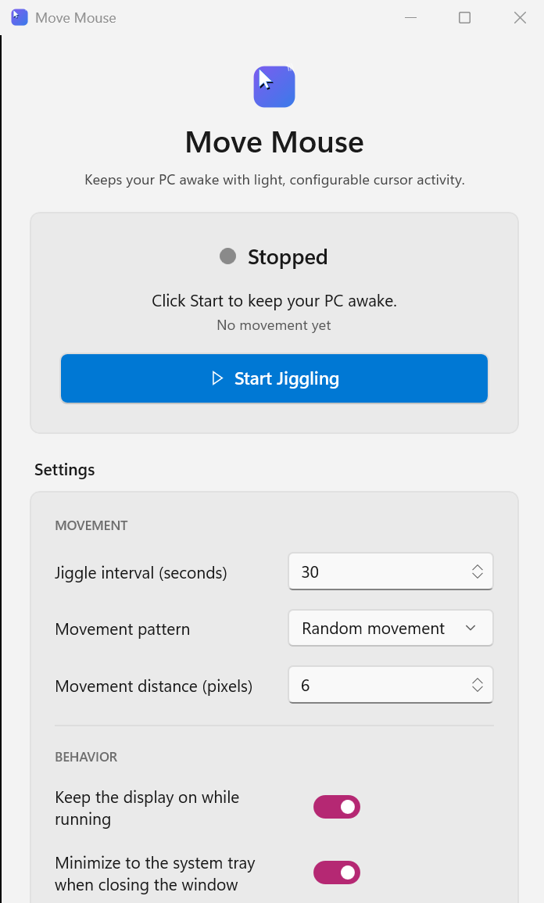
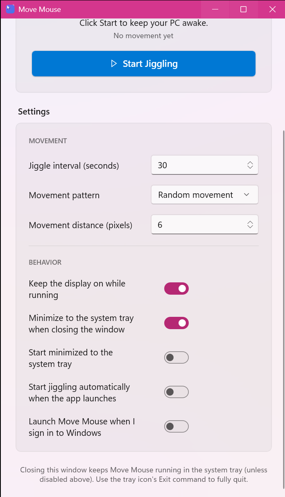
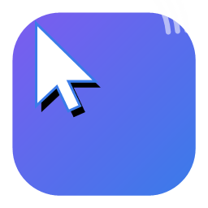

# Move Mouse

A modern, native Windows desktop application that gently simulates mouse activity to keep your PC from going to sleep, locking, or dimming the display — built with **C#**, **.NET**, and **WinUI 3** following Windows 11 Fluent Design.



## Overview

Move Mouse is a "mouse jiggler" utility for people who need their computer to stay awake and show as active — during long downloads, remote monitoring sessions, presentations, unattended demos, or simply to stop Windows from locking the screen during short breaks. Instead of a giant, jarring cursor swing, Move Mouse nudges the pointer by a small, configurable amount on a timer and tells Windows directly that the system should not sleep, using the same APIs Windows itself recommends for this purpose.

It is a fully unpackaged, self-contained WinUI 3 application: no MSIX installation or Microsoft Store is required. Clone, build, and run.

## Features

- **Mouse jiggler** — periodically moves the cursor by a small amount to simulate user activity.
- **Single Start/Stop toggle** — one button for both actions; its color, icon, and label (▶ *Start Jiggling* / ⏹ *Stop Jiggling*) always reflect what it will do next, so the dashboard never shows a redundant, permanently-disabled button.
- **Configurable interval** — choose how often the cursor moves, from 1 second up to 1 hour.
- **Multiple movement patterns**
  - **Random movement** — small, unpredictable nudges in any direction.
  - **Back and forth** — a subtle, repeating left/right wiggle.
  - **Circular nudge** — a tiny hexagonal approximation of a circle around the starting point.
- **Configurable movement distance** — 1–100 pixels.
- **Live status indicator** — a colored dot plus plain-English status text ("Running" / "Stopped"), a description of the active configuration, and a "last moved at" timestamp.
- **System tray support** — minimize to the notification area and keep running in the background; the tray icon itself changes to reflect whether jiggling is active, and its tooltip and right-click menu (Open / Start or Stop Jiggling / Exit) stay in sync with the app.
- **Sleep prevention** — uses the Win32 `SetThreadExecutionState` API to tell Windows the system (and, optionally, the display) must stay awake while running, and explicitly restores normal power management when stopped or when the app exits.
- **Settings persistence** — every preference (interval, pattern, distance, tray behavior, startup behavior) is saved to disk automatically and restored the next time the app launches.
- **Launch at Windows startup** — optional, per-user registration (no administrator rights required).
- **Robust error handling** — native API failures and unexpected errors are caught and shown as a clear, dismissible in-app banner instead of crashing the app.
- **Light / dark theme** — follows the Windows system theme automatically.
- **Accessible** — every interactive control exposes a proper accessible name for screen readers and UI automation.

## Screenshots

| Stopped | Running |
| --- | --- |
|  |  |

Every settings row — Movement and Behavior alike — shares the same two-column
grid (a flexible label on the left, a fixed-width control right-aligned to the
same edge), so the whole list reads as one evenly balanced, symmetric surface:



> The application icon (shown below) is a simple, original design generated for this project — a cursor with motion lines on a Fluent-style gradient tile.
>
> 

## Prerequisites

To **build** Move Mouse from source you need:

- Windows 10 version 1809 (build 17763) or later, or Windows 11 (recommended).
- [.NET SDK 9.0 or later](https://dotnet.microsoft.com/download) (the project targets `net10.0-windows10.0.19041.0`; adjust the `TargetFramework` in `src/MoveMouse/MoveMouse.csproj` if you only have an earlier SDK installed).
- Visual Studio 2022 17.8+ or Visual Studio 2026, **or** just the .NET SDK and `dotnet` CLI (no Visual Studio required).
- No Windows App SDK runtime installation is required — the app is built as **self-contained** (`WindowsAppSDKSelfContained=true`), so the Windows App Runtime binaries ship alongside the app.

To **run** the published app you only need a supported version of Windows 10/11 on x64 or ARM64 — no prerequisites to install.

## Repository layout

```
MoveMouse/
├── src/
│   ├── MoveMouse/             # WinUI 3 application (UI, view models, services, Win32 interop)
│   │   ├── Assets/            # App and tray icons
│   │   ├── Converters/        # XAML value converters
│   │   ├── Interop/           # P/Invoke declarations (SendInput, SetThreadExecutionState, ...)
│   │   ├── Models/            # AppSettings, MovementMode
│   │   ├── Services/          # Mouse jiggler, power management, settings, startup registration
│   │   ├── ViewModels/        # MainViewModel (CommunityToolkit.Mvvm)
│   │   ├── App.xaml(.cs)      # Application entry / composition root
│   │   └── MainWindow.xaml(.cs)
│   └── MoveMouse.Tray/        # Small class library providing the system tray icon
│                               # (kept separate because WinUI 3 + Windows Forms cannot
│                               #  coexist in a single project; see note in its .csproj)
├── tools/IconGen/              # One-off script used to generate the app/tray icons
├── docs/screenshots/           # Screenshots used in this README
├── MoveMouse.sln
├── LICENSE
└── README.md
```

### Architecture

Move Mouse follows a clean separation of concerns:

- **`Interop`** — all native Win32 interop (`SendInput`, `SetThreadExecutionState`, `GetCursorPos`, `GetSystemMetrics`) lives behind a single internal static class, isolated from the rest of the app.
- **`Services`** — small, single-purpose, interface-based services:
  - `IMouseJigglerService` — owns the timer and movement-pattern logic.
  - `IPowerManagementService` — owns sleep prevention and restoration.
  - `ISettingsService` — owns loading/saving JSON settings to local app data.
  - `IStartupService` — owns the Windows "launch at sign-in" registration.
  - `ITrayIconService` (in `MoveMouse.Tray`) — owns the notification-area icon, menu, and balloon notifications.
- **`ViewModels`** — `MainViewModel` (built with [CommunityToolkit.Mvvm](https://github.com/CommunityToolkit/dotnet)) coordinates the services and exposes bindable state/commands; it contains no direct Windows API calls.
- **`App.xaml.cs`** — the composition root: constructs every service and the view model, and owns application lifetime (startup, exit, unhandled-exception safety net).
- **UI (XAML)** — binds only to the view model via classic `{Binding}`; all visuals use the control's own theme-aware default styling plus a handful of explicit, hardcoded accent/card colors (see the note at the top of `MainWindow.xaml` — in this project's unpackaged deployment, several named theme resources are not reliably resolved at XAML load time, so the UI intentionally avoids depending on them). Every settings row shares one consistent two-column grid (flexible label, fixed-width right-aligned control) for a symmetric, evenly balanced layout, and the window is sized through a DPI-aware helper so that layout looks correct at any Windows display scaling setting.

## Build instructions

Clone the repository and build with the .NET CLI:

```powershell
git clone https://github.com/erentechlabs/MoveMouse.git
cd MoveMouse
dotnet build MoveMouse.sln -c Release -p:Platform=x64
```

Or open `MoveMouse.sln` in Visual Studio, select the `x64` (or `ARM64`) platform and `Release` configuration, and press **Build**.

The runnable application is produced at:

```
src/MoveMouse/bin/x64/Release/net10.0-windows10.0.19041.0/MoveMouse.exe
```

### Publishing a single, self-contained build

To produce a redistributable folder that runs on a machine without any .NET or Windows App SDK installation:

```powershell
dotnet publish src/MoveMouse/MoveMouse.csproj -c Release -r win-x64 --self-contained true -p:Platform=x64
```

Replace `win-x64` with `win-arm64` for ARM64 devices.

## Usage

1. Launch `MoveMouse.exe`.
2. Click **Start Jiggling** to begin — the status dot turns green, the button itself turns red and relabels to **Stop Jiggling**, Windows is told to stay awake, and the cursor will move by the configured amount at the configured interval.
3. Click the same button (now **Stop Jiggling**) at any time — the timer stops and normal Windows power management is restored immediately.
4. Adjust **Movement settings** (interval, pattern, distance) at any time, whether running or stopped; changes apply immediately and are saved automatically.
5. Adjust **Behavior** options:
   - *Keep the display on while running* — also prevents the monitor from turning off, not just the system from sleeping.
   - *Minimize to the system tray when closing the window* — clicking the window's **X** hides it instead of exiting; Move Mouse keeps running in the background.
   - *Start minimized to the system tray* — skip showing the window on launch.
   - *Start jiggling automatically when the app launches* — begin jiggling immediately on startup.
   - *Launch Move Mouse when I sign in to Windows* — registers/unregisters a per-user startup entry.
6. Use the **system tray icon** to reopen the window (click), or right-click it for **Open Move Mouse**, **Start/Stop Jiggling**, and **Exit**.
7. Choose **Exit** from the tray menu (or disable "minimize to tray" and close the window) to fully quit — this always stops jiggling and restores normal power management first.

Settings are stored in `%LOCALAPPDATA%\MoveMouse\settings.json`.

## How sleep prevention works

Move Mouse calls the Win32 [`SetThreadExecutionState`](https://learn.microsoft.com/windows/win32/api/winbase/nf-winbase-setthreadexecutionstate) API with `ES_CONTINUOUS | ES_SYSTEM_REQUIRED` (and optionally `ES_DISPLAY_REQUIRED`) when you start jiggling, and resets it to `ES_CONTINUOUS` alone — restoring normal behavior — when you stop jiggling, when the app exits, or if it encounters an unhandled error. Because this flag is tied to the application's UI thread for as long as the process runs, there is no need to re-issue the call on every tick.

Cursor movement itself is generated with [`SendInput`](https://learn.microsoft.com/windows/win32/api/winuser/nf-winuser-sendinput), the modern, Microsoft-recommended replacement for the legacy `mouse_event` API, using small relative moves that are clamped to the virtual screen bounds so the cursor never flies off-screen.

## Testing performed

This application was built and verified end-to-end on a real Windows machine:

- `dotnet build` succeeds for both `Debug` and `Release`, `x64`, with zero warnings and zero errors.
- The app launches, and the dashboard renders correctly with no exceptions.
- **Start** engages the timer (verified by watching the "last moved at" timestamp advance on schedule) and **Stop** halts it immediately (verified by the timestamp freezing); the single toggle button correctly flips color/icon/label and the status dot/text in lockstep with the jiggler's actual running state.
- Settings changes made in the UI are written to `settings.json` immediately and are reloaded correctly on the next launch.
- The system tray icon appears with the correct icon/tooltip for each state, its right-click menu items match the running state, left-clicking it restores the window, and its **Exit** command cleanly terminates the process.
- Closing the window with "minimize to tray" enabled hides the window while the process keeps running in the background; the window can be restored from the tray.
- The "Launch at Windows startup" toggle correctly creates and removes the `HKCU\Software\Microsoft\Windows\CurrentVersion\Run` registry value.
- Exiting the app (via the tray **Exit** command) always completes without errors, having already stopped the jiggler and restored normal power management.

## Known limitation

In this unpackaged deployment configuration, a handful of WinUI 3's *named* theme resources (e.g. some used internally by `ComboBox` and `InfoBar`) are not reliably resolved at XAML load time in every environment. The UI works around this by using the built-in default control styles (unaffected) plus a small set of explicit, hardcoded colors for cards and the error banner, rather than the semantic `SystemFillColor*`/`CardBackgroundFillColorDefaultBrush` theme resources. The app still fully adapts to the Windows light/dark theme because every built-in control's own default appearance is theme-aware; only a few custom accent/card colors are fixed.

## License

Licensed under the [MIT License](LICENSE).
